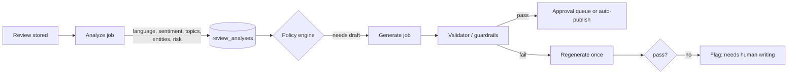
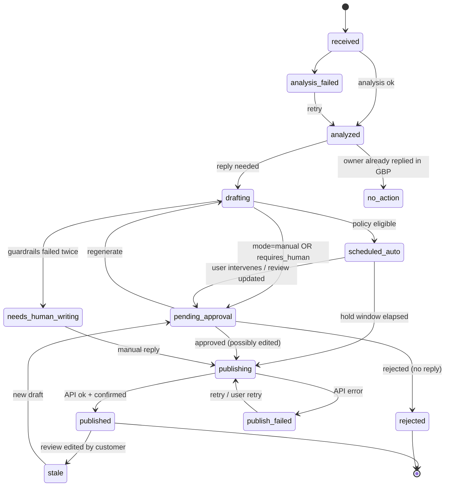

# 04 — Complete Feature Specification

## A. Google Business Profile integration

Full API detail is in [07](07-api-integration-spec.md). Product behaviour:

| Capability | Behaviour | Notes |
|-----------|-----------|-------|
| Connect | "Connect Google" → OAuth consent with scope `https://www.googleapis.com/auth/business.manage` [V], `access_type=offline`, `prompt=consent` | Store the refresh token encrypted. One Google account can expose many GBP accounts and locations. |
| Discover | List GBP accounts → locations. The user ticks the locations to import. | Only **verified** locations can list reviews or reply [V]. Unverified locations are shown as "not eligible". |
| Import / backfill | Page through all reviews, 50 per page max [V], oldest history included | Queue a low-priority job. Show progress. |
| Incremental sync | Pub/Sub `NEW_REVIEW` / `UPDATED_REVIEW` notifications [V], plus polling fallback every 15–60 minutes, plus a nightly reconciliation | Notifications only carry resource names, so a fetch is needed [V]. |
| Review updates | The reviewer edits text or rating, so a revision is stored, analysis re-run, and any pending draft marked *stale* | |
| Deleted reviews | Missing during reconciliation → `removed_at` set, hidden by default | |
| Publish reply | `PUT …/reviews/{id}/reply` [V]. Retries with backoff. Confirms by re-fetching. | Replies can be rejected for policy violations, and the API now exposes these [V-2]. Surface them to the user. |
| Edit / delete reply | Supported (update replaces; deleteReply [T]) | Audited |
| Disconnect | Revoke the token, stop sync, enter a 30-day retention window, then purge (configurable) | |
| Errors | Token revoked → connection `needs_reauth` plus an email to the owner. 429 → backoff and a global rate limiter. 403 on location → mark it ineligible. | |

**Explicitly not available via the API** (do not promise):
- Reviewer email or phone. Only display name, profile photo URL and an anonymity flag are available [T].
- Visit date. The review time is not the visit time.
- Reviews from competitors' profiles (only Places API public data; see §G).

## B. AI response engine

### B1. Pipeline per review

### B2. Analysis (one structured LLM call, JSON schema output)

Outputs:
- `language` (BCP-47), `language_confidence`
- `sentiment_score` (−1…1) and `sentiment_label`
- `topics[]` from the fixed taxonomy (see §E), each with `polarity` and `evidence` (a quote span)
- `entities`: `dishes[]`, `staff_mentions[]` (names are pseudonymised in analytics), `visit_context` (dine-in, delivery, takeaway, event), `day_part` (if stated)
- `risk_flags[]`: `food_safety` (illness, allergy, foreign object), `hygiene`, `discrimination`, `legal_threat`, `health_authority`, `staff_misconduct`, `refund_request`, `personal_data`, `profanity`, `suspected_fake`, `competitor_mention`, `employee_review`, `off_topic`
- `risk_score` (0–100), `requires_human` (bool) with `reasons[]`
- `summary` (one line, for the inbox)
- `reply_needed` (false for empty-text 5★? **No**. Empty-text reviews still get a short thank-you, per the product principle.)

Cost control: rating-only reviews (no text) skip the LLM analysis. Use deterministic rules, and a templated draft pool with variation.

### B3. Generation

Prompt inputs, assembled by `PromptBuilder` and versioned:
1. System: role, absolute rules (no invented facts, no promises of compensation unless policy allows, no reviewer personal data beyond first name, never admit legal liability, never argue).
2. Brand voice (resolved org → location), with forbidden and preferred phrases.
3. **Location fact sheet:** the only facts allowed (hours, address, services, policies, contact channel for complaints).
4. Review text, rating, analysis output.
5. **Style memory:** 3–5 recent *approved* replies from this location (few-shot), selected to differ in topic. This prevents drift and repetition.
6. **Anti-repetition:** n-gram fingerprints of the last 30 published replies, each with an instruction to avoid repeating openings and closings.
7. Output: JSON with 2–3 variants (`short`, `standard`, `warm`), each with `text`, `language`, `claims_used[]` (fact IDs referenced).

### B4. Guardrails (deterministic, post-generation)

| Check | Action on fail |
|-------|----------------|
| Language ≠ review language (unless the location forces a language) | regenerate |
| Contains a forbidden phrase | regenerate |
| Mentions a fact not in `claims_used`, or a fact ID not in the fact sheet | regenerate, then flag |
| Contains an email or phone number not in the fact sheet | strip and flag |
| Length outside the configured range, or > 4,096 chars (GBP limit [T]) | regenerate |
| Similarity > 0.85 to any of the last 30 replies (MinHash / trigram) | regenerate |
| Contains promises (refund, free meal, discount) and the policy disallows them | flag `requires_human` |
| Moderation (provider moderation endpoint) | block |

### B5. Variation and regeneration
- The user can regenerate with a hint ("mention we fixed the AC", "shorter", "more formal").
- Each generation is stored (`ai_generations`) with model, prompt version, tokens, cost and latency.

### B6. Model strategy [A]
- Analysis uses a small, cheap model with JSON schema / structured outputs.
- Generation uses a mid-tier model for quality. The model is configurable per plan.
- Use a provider abstraction (OpenAI first, with a second provider such as Anthropic as fallback) so one vendor outage doesn't stop the product.
- Run an evaluation set (≥ 300 real anonymised reviews across NL/EN/DE, all star levels) on every prompt or model change. Score with rubric-based LLM-as-judge plus human spot checks.

## C. Approval workflow

### C1. Review & draft state machine

### C2. Operating modes (per location, overridable by the org)

| Mode | Behaviour |
|------|-----------|
| **Manual** | Every draft goes to the queue. |
| **Smart Approval** (default) | Auto-publishes **only** when all of these hold: rating ≥ threshold (default 4★), `risk_score` < threshold (default 20), no risk flags, analysis confidence ≥ 0.8, language supported, and the review is not an edit of a previously negative review. Everything else goes to the queue. |
| **Auto-Pilot** | Like Smart, but with configurable thresholds. The org admin can include 3★ reviews. **1–2★ reviews and any `food_safety`, `discrimination`, `legal_threat` or `health_authority` flag always require a human. This is not configurable.** |

Safeguards for all automated publishing:
- **Hold window** (default 2 h, minimum 15 min): the reply waits in `scheduled_auto` and can be cancelled.
- **Daily cap** per location (default 20 auto-replies).
- **Kill switch** per org and per location, plus a global kill switch in admin.
- **Circuit breaker:** if more than X% of auto-replies in 24 h are edited or deleted by humans afterwards, automation pauses and the admin is notified.
- **Business-hours mode:** optionally publish only between 08:00 and 22:00 local time (replies at 03:00 look automated).

### C3. Approval queue
- Grouped by urgency: high-risk first, then oldest.
- SLA badges ("waiting 26 h").
- Bulk approve, only for drafts with risk < threshold.
- Keyboard shortcuts: `A` approve, `E` edit, `R` regenerate, `X` reject, `J/K` navigate.
- Optional **two-step approval** for groups, where a location manager drafts and HQ approves negative replies.

### C4. Audit
Every transition writes an `audit_logs` row with actor (user / system / automation policy ID), before and after, IP and user agent. The review detail page shows this as a timeline.

## D. Restaurant Personality (Brand Voice) Engine

| Setting | Type | Default |
|---------|------|---------|
| Formality | 1–5 slider (je/jij ↔ u in Dutch) | 3 (NL: "je" default for casual brands, "u" for fine dining) |
| Warmth | 1–5 | 4 |
| Humor | none / light / playful | light |
| Emoji | never / positive reviews only / allowed | never |
| Length | short (≤ 40 words) / standard (40–90) / detailed (90–150) | standard |
| Sign-off | free text, e.g. "Team Burgerbar Utrecht", "Sanne, bedrijfsleider" | location name |
| Preferred language | auto (review language) / fixed | auto |
| Preferred phrases | list | — |
| Forbidden phrases | list (e.g. "sorry for the inconvenience", "we value your feedback") | seeded generic-cliché list |
| Brand guidelines | markdown, max 2,000 chars | — |
| Special instructions | markdown, max 1,000 chars ("always invite negative reviewers to email klachten@…") | — |
| Compensation policy | none / may invite to contact / may offer (manager only) | invite to contact |
| Fact sheet | structured key-value facts | imported from GBP (hours, address) |

Rules:
- **Inheritance:** org voice → location override (field-level). The UI shows "inherited" vs "overridden".
- **Versioning:** each save creates an immutable `brand_voice_versions` row. Drafts reference the version used.
- **Preview:** "test this voice" runs three sample reviews (5★, 3★, 1★) live.
- **Onboarding wizard:** paste 5 past replies you like, and the AI proposes initial settings.

## E. Negative review intelligence

### E1. Topic taxonomy (hospitality v1, fixed and versioned)

Two levels; about 30 leaf topics:
- **Food:** taste, temperature, portion size, freshness/quality, menu variety, dietary/allergy handling, presentation
- **Service:** friendliness, speed/wait time, attentiveness, order accuracy, staff knowledge
- **Venue:** cleanliness/hygiene, toilets, ambience/noise, seating/comfort, accessibility, parking
- **Value:** price level, value for money, billing errors
- **Operations:** reservations, opening hours accuracy, takeaway/delivery, payment options
- **Other:** management response, events, other

A fixed taxonomy beats free-form topics: it allows trends, comparisons and benchmarks. Free-form keywords are kept separately as `keywords[]` for discovery, and the taxonomy can be extended per vertical later.

### E2. Analytics derived
- Topic share and net sentiment per topic per location per week/month.
- **Spike detection:** a topic's negative mention rate in the last 14 days vs a 90-day baseline. Alert when it exceeds 2× **and** at least N mentions (to avoid alerting on 1→2). Start with simple, explainable stats (Poisson/binomial test), not ML.
- **Dish-level sentiment:** dishes mapped to a per-location menu list (user-maintained, with suggested auto-detected dishes).
- **Location comparison:** topic sentiment z-scores vs group average.
- **Monthly insights:** an LLM-written narrative **over computed aggregates only** (never raw guesses), with each claim linked to the underlying reviews.

### E3. Issues (the differentiator)
- An Issue = title, topic(s), location(s), owner, status (open → in progress → resolved → verified), due date, notes, linked reviews.
- Created manually from an insight or alert, or suggested automatically.
- **Outcome measurement:** after resolution, compare the topic's negative mention rate in the 30/60 days after vs before, and show "Complaints about *wait time* at Utrecht ↓ 58% since resolved". Include sample-size caveats.
- Optional: the reply drafts for linked reviews can reference that the issue was addressed, but only once it is marked resolved and the manager confirms.

## F. Multi-location management

- **Hierarchy:** Organisation → (optional) Location Groups / Regions → Locations. Groups are tags, not a deep tree, to avoid complexity.
- **Roles (org-level):** Owner, Admin, Analyst (read-only analytics), Billing.
- **Location-level roles:** Manager (approve/reply), Contributor (draft only), Viewer.
- **Centralised approval:** the HQ queue across all locations, with per-location filters.
- **Org-level settings:** default voice, automation ceilings (locations cannot exceed org limits), forbidden phrases (always inherited and additive), notification defaults.
- **Leaderboards:** response rate, response time, rating delta, issue closure. Use them carefully, since they can create incentives to game. Show them to HQ only by default.

## G. Competitor intelligence (Phase 7, constrained)

What is legally and technically possible:
- **Google Places API (New)** Place Details exposes public `rating`, `userRatingCount` and **at most 5 reviews** [V-2]. Reviews and atmosphere fields are billed at the Enterprise + Atmosphere SKU, about $25 per 1,000 requests at list price [V-2] ([Google pricing](https://developers.google.com/maps/billing-and-pricing/pricing)).
- Places policies restrict caching. `place_id` is exempt from caching restrictions [V-2], but other content generally may not be cached long-term [V-2], and attributions must be displayed [V-2] ([Places policies](https://developers.google.cn/maps/documentation/places/web-service/policies?hl=en)).
- **Legal review is required** before storing historical competitor rating time series. The conservative MVP design: store `place_id` only, fetch live on view (cost-capped), and show "current rating / review count vs you".
- **Not possible:** full review history, competitor topic analysis at scale (5 reviews is not a sample), private data.

**Verdict:** a light "benchmark" card (you vs up to 5 nearby competitors, live) is the defensible scope. "Competitor complaint themes" based on 5 reviews would be statistically meaningless, so **do not build it**.

## H. Additional features: evaluated and prioritised

Scores: Value (customer problem × willingness to pay) and Complexity on a scale of 1–5.

| Feature | Value | Complexity | Decision |
|---------|-------|-----------|----------|
| **Issues & outcome measurement** | 5 | 3 | **Build (Phase 5).** Core differentiator. |
| **Weekly digest + monthly PDF report** | 5 | 2 | **MVP** (digest), Phase 5 (PDF) |
| **Review collection (QR, link, NFC, receipt/reservation integrations)** | 5 | 3 | **Phase 6–7**, no gating |
| **Dish/menu-level sentiment** | 4 | 2 | Phase 5 |
| **Response SLA tracking & leaderboards** | 4 | 1 | Phase 5 |
| **Multi-language replies (NL/EN/DE/FR + tourist languages)** | 4 | 1 | MVP (comes almost for free with LLMs) |
| **Slack / Teams alerts** | 3 | 1 | Phase 6 |
| **WhatsApp alerts (high-risk reviews only)** | 3 | 3 | Phase 7. Requires the WhatsApp Business Platform, template approval and per-message cost [T]. |
| **Mobile PWA with push** | 4 | 2 | Phase 6 |
| **Reply-impact analysis** (do reviewers update their rating after a reply?) | 3 | 2 | Phase 7. Interesting, but the data is noisy. |
| **POS / reservation integrations** (invite triggers, visit context) | 5 | 4 | Phase 7+, partner-dependent |
| **Franchise mode** (franchisor sees all, franchisee owns billing) | 4 | 4 | Phase 7 |
| **Agency / white-label** | 3 | 5 | Defer until demand is proven |
| **Public review widget** | 2 | 2 | Defer. Verify that GBP terms allow display. |
| **AI reputation score** | 2 | 2 | Only as an *explained* composite in reports, not a headline feature |
| **Trend forecasting** | 1 | 3 | **Cut.** Volumes are too low per location, so forecasts would be noise. |
| **Competitor complaint themes** | 1 | 3 | **Cut** (5-review sample, caching rules) |
| **Other review sources** (Facebook, Tripadvisor, TheFork) | 4 | 4 | Phase 7+. Tripadvisor's Content API reportedly lacks full reviews and restricts storage [V-2]. Evaluate each source's terms. |
