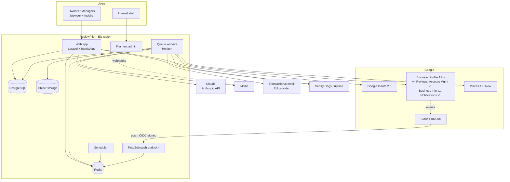
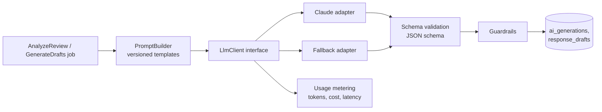
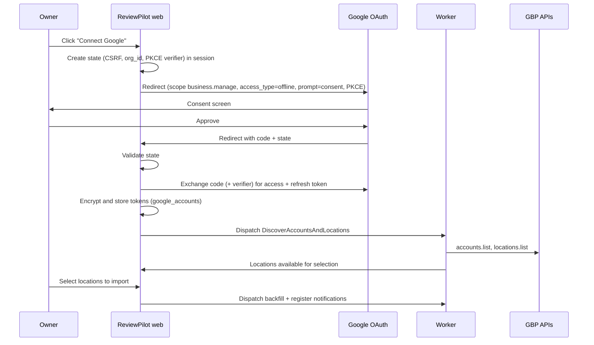

# 05 — Technical Architecture

## 1. Stack evaluation

| Proposed                                                                  | Verdict                    | Notes                                                                                                                                                                                                                                               |
| ------------------------------------------------------------------------- | -------------------------- | --------------------------------------------------------------------------------------------------------------------------------------------------------------------------------------------------------------------------------------------------- |
| **Laravel 13**                                                            | ✅ Keep                    | Released in March 2026, requires PHP ≥ 8.3, security fixes until about Q1 2028 [V-2] ([Laravel News](https://laravel-news.com/laravel-13-released)). Plan the upgrade to Laravel 14 (expected around Q1 2027) into the roadmap.                     |
| **PHP 8.4+**                                                              | ✅ Keep                    | Within Laravel 13's supported range (8.3–8.5 reported [V-2]). Standardise on **PHP 8.4** in Docker and CI.                                                                                                                                          |
| **Vue 3 + Inertia.js**                                                    | ✅ Keep                    | A good fit for a dashboard-heavy SaaS with server-side routing and auth. Use TypeScript. Generate typed routes (Ziggy or Wayfinder [T]).                                                                                                            |
| **Tailwind CSS 4**                                                        | ✅ Keep                    | Use its CSS-first `@theme` tokens for the design system.                                                                                                                                                                                            |
| **Filament** (internal admin)                                             | ✅ Keep, **internal only** | Use the version compatible with Laravel 13 (check at project start [T]). Never expose it to customers. Separate panel guard plus IP allowlist or SSO.                                                                                               |
| **PostgreSQL**                                                            | ✅ Keep                    | Use 16 or 17. JSONB for analysis payloads, partial indexes, partitioning for logs, `pg_trgm` for search.                                                                                                                                            |
| **Redis**                                                                 | ✅ Keep                    | Queues, cache, rate limiters, locks. Managed and EU-hosted.                                                                                                                                                                                         |
| **Laravel Queues + Scheduler**                                            | ✅ Keep                    | Add **Laravel Horizon** for queue supervision and metrics.                                                                                                                                                                                          |
| **Claude (Anthropic API)** — _decided, replaces OpenAI_                   | ✅ Behind an abstraction   | Called via the official Anthropic PHP SDK (`ClaudeClient`) with JSON-schema structured outputs, effort per task and server-side refusal fallbacks. Wrapped in the `LlmClient` interface, with an offline `FakeLlmClient` for development and tests. |
| **Mollie** — _decided_                                                    | ✅                         | Direct integration via `mollie/laravel-mollie` (first payment with iDEAL/card creates a mandate, then a Mollie subscription charges monthly by SEPA Direct Debit or card). Per-location quantity is synced to the subscription amount.              |
| _(added)_ **Laravel Reverb**                                              | Optional                   | Real-time inbox updates. Polling every 30 s is acceptable at first.                                                                                                                                                                                 |
| _(added)_ **Laravel Pennant**                                             | ✅ Add                     | Feature flags for plan gating and gradual rollout (Auto-Pilot beta).                                                                                                                                                                                |
| _(added)_ **Sentry** (or Flare)                                           | ✅ Add                     | Error tracking.                                                                                                                                                                                                                                     |
| _(added)_ **Object storage** (S3-compatible, EU)                          | ✅ Add                     | PDF reports, exports, backups.                                                                                                                                                                                                                      |
| _(rejected)_ Microservices, Kubernetes on day one, multi-database tenancy | ❌                         | Unnecessary complexity before product-market fit.                                                                                                                                                                                                   |

**Hosting (EU)** [A]: Laravel Cloud (EU region), Laravel Forge on Hetzner or DigitalOcean AMS, or AWS `eu-central-1`. All are viable. Requirements: EU data residency, managed Postgres with PITR, managed Redis, and separate worker capacity. **Recommendation:** start with a managed PaaS (Laravel Cloud or Forge + managed DB) to minimise ops work. Revisit at about 3,000 locations.

## 2. Clean project structure (new, isolated repository)

The repository currently contains only this blueprint. Establish ReviewPilot as follows:

1. `laravel new reviewpilot` (Vue + Inertia starter kit, TypeScript) at the repo root, in a dedicated commit "chore: scaffold Laravel 13 application".
2. Remove any starter-kit demo pages that won't be used. Keep auth scaffolding only if it matches the requirements in [10](10-security-compliance.md).
3. Add the tooling commit: Pint, Larastan (level 8), Pest, ESLint + Prettier, Vitest, Playwright, GitHub Actions CI, Docker Compose (pgsql, redis, mailpit).
4. Keep `docs/blueprint/` as the living spec. Use ADRs in `docs/adr/` for any deviation.

### Modular monolith layout

```
app/
  Domain/                      # business logic, framework-light
    Tenancy/                   # Organization, Membership, Location, Policies, TenantContext
    Identity/                  # User, auth, 2FA, invitations
    Google/                    # OAuth, GBP client, DTOs, sync services
    Reviews/                   # Review, ReviewRevision, ingestion, state machine
    Intelligence/              # Analysis, topics, aggregates, alerts, issues
    Responses/                 # Drafts, generation, guardrails, publishing
    Voice/                     # BrandVoice, versions, fact sheets
    Automation/                # Policies, eligibility, hold/schedule, circuit breaker
    Billing/                   # Plans, entitlements, usage metering
    Notifications/             # Channels, digests, preferences
    Audit/                     # AuditLogger, events
    Ai/                        # LlmClient interface, providers, PromptBuilder, Evals
  Http/                        # Controllers (thin), Requests, Resources, Middleware
  Jobs/                        # Queue jobs (thin wrappers around Domain actions)
  Filament/                    # Internal admin only
resources/js/
  pages/  components/  layouts/  composables/  lib/  types/
tests/
  Unit/  Feature/  Architecture/  (Pest arch tests enforce module boundaries)
```

Conventions:

- **Actions** (single-purpose classes such as `PublishReply`, `GenerateDrafts`) are the unit of business logic, called from controllers, jobs and Filament.
- **Domain events** (`ReviewReceived`, `ReviewAnalyzed`, `DraftApproved`, `ReplyPublished`) decouple modules.
- **Pest arch tests** forbid, for example, `Intelligence` from importing `Google` internals.

## 3. System context



## 4. Multi-tenancy strategy

**Choice: a single database with a shared schema and an `organization_id` column on every tenant-owned table.**

| Option                            | Pros                                           | Cons                                                                            | Verdict            |
| --------------------------------- | ---------------------------------------------- | ------------------------------------------------------------------------------- | ------------------ |
| DB per tenant                     | Strong isolation                               | Migration and ops pain at thousands of tenants, cross-tenant analytics are hard | ❌                 |
| Schema per tenant                 | Medium isolation                               | Same ops pain, and Postgres struggles with thousands of schemas                 | ❌                 |
| **Shared schema + tenant column** | Simple, cheap, easy aggregation and benchmarks | Isolation relies on discipline                                                  | ✅ with safeguards |

Safeguards:

1. `TenantContext` is resolved from the authenticated membership and the current org (URL segment `/o/{org}` or session). It is immutable per request or job.
2. A `BelongsToOrganization` trait adds a global scope plus `creating` hook to set `organization_id`. The scope throws if no tenant context exists, except for explicit `withoutTenancy()` system calls.
3. **Composite foreign keys** `(organization_id, id)` on critical child tables (e.g. reviews → locations), so a review cannot reference another org's location even through a bug.
4. **Laravel Policies** for every model, plus location-scope checks via membership.
5. **Automated isolation test suite:** for every route, a user from org B gets 403/404 on org A's resources (generated from the route list).
6. **Postgres Row-Level Security (Phase 6+, optional):** `SET app.org_id` per transaction, with RLS policies on the largest tables as defense-in-depth. Defer, because it complicates pooling and queues.
7. Jobs serialise `organization_id` and restore `TenantContext` in middleware.

## 5. Authentication & authorisation

- **Laravel Fortify** (headless) for email/password, verification, password reset and TOTP 2FA. Use Inertia pages for the UI.
- **Google sign-in** via Socialite (scopes `openid email profile`), **separate** from the GBP connection. Don't request `business.manage` at login. This minimises the scope requested from users who only sign in.
- Sessions use HttpOnly, Secure, SameSite=Lax cookies, with session rotation on login.
- 2FA is **required for Owner/Admin roles** on Group plans, and optional otherwise.
- Authorisation uses Policies plus a `Permission` enum resolved from org role and location role (see [06](06-database-schema.md) §memberships). No heavy RBAC package is needed. Roles are a fixed set.
- Support impersonation (Filament) only with an audit entry and a visible banner, plus customer consent in a setting for EU good practice.

## 6. API architecture

- **Internal:** Inertia controllers plus a small JSON API (`/api/internal/*`, session auth) for async UI parts (draft polling, autosave).
- **Inbound webhooks:**
    - `POST /webhooks/google/pubsub` verifies the OIDC JWT from Pub/Sub push (audience + service account email) [T]. Dedupe by `message.messageId`, store in `inbound_events`, return 204 quickly, and process async.
    - `POST /webhooks/billing/{provider}` verifies the signature and is idempotent.
- **Public API (Phase 7+):** versioned `/api/v1`, Sanctum tokens per org, rate-limited. Only build this when partners need it.

## 7. Queue architecture

| Queue           | Jobs                                                      | Priority / workers [A]                              |
| --------------- | --------------------------------------------------------- | --------------------------------------------------- |
| `realtime`      | Process Pub/Sub event, fetch single review, publish reply | High, 4+ workers                                    |
| `ai`            | AnalyzeReview, GenerateDrafts                             | Medium, concurrency-limited per provider rate limit |
| `sync`          | PollLocation, ReconcileLocation                           | Medium                                              |
| `backfill`      | Initial import (paged, chained)                           | Low, so it can't starve others                      |
| `reports`       | Aggregates, digests, PDFs                                 | Low, mostly nightly                                 |
| `notifications` | Email, Slack                                              | Medium                                              |

Patterns:

- **Idempotency:** jobs are keyed (e.g. `publish:{draft_id}`) with `ShouldBeUnique` and DB-level unique constraints. Publishing uses a `publication_attempts` row with a state check.
- **Rate limiting:** a global Redis limiter for the GBP project quota (default **300 QPM** per project [V]), shared across all workers (`RateLimiter::attempt` or `Redis::throttle`), with headroom (target ≤ 240 QPM). There is a per-location limiter too.
- **Retries:** exponential backoff with jitter. Errors are classified as retryable (429, 5xx, timeouts) or terminal (400 invalid, 403 permission, 404 deleted).
- **Dead-letter:** failed jobs are visible in Horizon and Filament, with a replay action.
- **Batching:** backfill uses `Bus::batch` per location, with progress shown in the UI.

## 8. AI integration architecture



- **Structured outputs** (JSON schema) for analysis and drafts. Validate with a PHP schema validator, and retry once on invalid output.
- **Prompt versions** live in code (`resources/prompts/*.md` + `PromptVersion` enum). Each version has an eval score recorded in CI (a nightly eval job on a fixed dataset).
- **Cost guardrails:** per-org monthly AI budget derived from plan entitlements. Soft warning at 80%. Hard stop goes to manual mode, never a silent failure.
- **Data minimisation:** send the reviewer's first name only (or none), never their photo URL. Strip emails and phones found in the review before sending.
- **Caching:** identical analysis input (rating-only) gets templated handling with no LLM call.
- **Timeouts:** 30 s, with circuit breaker per provider and failover.

## 9. Google OAuth architecture



Token handling:

- The access token is cached (encrypted) until expiry minus 5 minutes. Refresh happens under a Redis lock per Google account, to avoid refresh stampedes.
- `invalid_grant` on refresh sets the connection to `needs_reauth`, pauses automation for affected locations, and notifies the owner.
- Store the Google `sub` and email to detect the same Google account connected to two orgs. Allow it, but flag it in admin, since agencies do this.

## 10. Synchronisation strategy

Three layers (defense in depth):

1. **Push:** a GBP Notifications API setting per GBP account points to the ReviewPilot Pub/Sub topic, with `NEW_REVIEW` and `UPDATED_REVIEW` [V]. The push subscription goes to our webhook, and the job fetches that review.
2. **Poll:** every 15 min (Pro/Group) or 60 min (Essentials), list reviews ordered by `updateTime desc` [V] until reaching an already-seen `update_time`. That is usually 1 call per location.
3. **Reconcile:** nightly per location, a full or partial walk (last 90 days), to detect deleted reviews, missed updates and owner replies made directly in GBP.

Quota math [A]: 5,000 locations × 4 polls per hour = 20,000 calls per hour ≈ 333 QPM. That **exceeds the 300 QPM default** [V]. So:

- push is mandatory at scale, and polling becomes adaptive (busy locations more often; quiet ones every 2–6 h);
- request a quota increase (possible via the Quotas page [V-2]) before about 2,000 locations.

## 11. Caching

| What                   | Where                                                                                               | TTL                           |
| ---------------------- | --------------------------------------------------------------------------------------------------- | ----------------------------- |
| Dashboard aggregates   | Postgres summary tables (`location_daily_stats`) updated by jobs, plus Redis for hot org dashboards | 5 min                         |
| Entitlements per org   | Redis                                                                                               | 10 min, busted on plan change |
| Google access tokens   | Redis (encrypted)                                                                                   | expiry − 5 min                |
| Places competitor data | **Per the Places policies** (place_id only long-term)                                               | Verify the allowed TTL        |
| Config, routes, views  | Laravel optimise                                                                                    | deploy                        |

## 12. Logging, monitoring, error handling

- **Structured JSON logs** with `correlation_id`, `organization_id`, `location_id` and `job`, sent to a log platform (Better Stack, Axiom or Grafana Loki, EU region).
- **Sentry** for exceptions (PII scrubbing on), with frontend errors included.
- **Metrics/alerts:** queue latency per queue, failed jobs per hour, GBP 429 rate, LLM error rate and cost per day, publish success rate, sync freshness (max time since last successful sync per location > 2 h fires an alert).
- **Uptime:** external checks on the app and the webhook endpoint.
- **User-facing errors:** each failure state has a human explanation and an action ("Reconnect Google", "Retry publish").
- **Health dashboard in Filament:** connections needing reauth, stale syncs, failed publishes.

## 13. Security (summary; detail in [10](10-security-compliance.md))

- Encrypted columns for OAuth tokens using Laravel's encrypted cast with a **dedicated key**. Rotate it via `APP_PREVIOUS_KEYS`.
- Secrets live in the platform secret store, never in the repo.
- CSP, HSTS, a strict CORS (none needed), CSRF on everything, rate limits on login and invitations.
- Dependency scanning (Composer audit, npm audit, Dependabot) and SAST in CI.

## 14. Rate limiting (inbound)

- Login: 5 per minute per IP+email. Password reset: 3 per hour.
- Regenerate draft: 10 per minute per user, and plan-based monthly caps.
- Webhooks: no user limit, but signature verification first, plus payload size limits.

## 15. Backup & disaster recovery

- Managed Postgres with **point-in-time recovery (≥ 7 days)** plus daily logical dumps to separate EU object storage (30-day retention, encrypted).
- Redis is treated as ephemeral. Queues must be re-creatable via the reconcile jobs.
- **RPO ≤ 15 min, RTO ≤ 4 h** (year 1). Run quarterly restore drills.
- Infrastructure is defined as code where the platform allows it.
