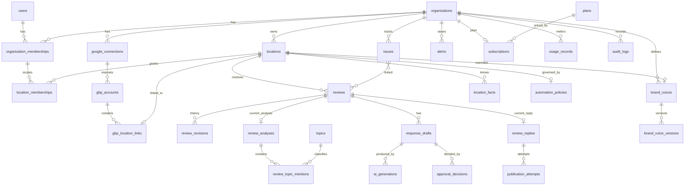

# 06 — Database Schema & Entity Relationships

PostgreSQL 16+. These are design notes, **not migrations**.

## 1. Global conventions

| Decision      | Choice                                                                                  | Reasoning                                                                                                                             |
| ------------- | --------------------------------------------------------------------------------------- | ------------------------------------------------------------------------------------------------------------------------------------- |
| Primary keys  | `uuid` (UUIDv7, time-ordered)                                                           | Safe to expose in URLs, no enumeration, index-friendly ordering. Laravel `HasUuids` generates ordered UUIDs [T].                      |
| Tenant column | `organization_id uuid not null` on every tenant table                                   | Shared-schema tenancy ([05 §4](05-technical-architecture.md))                                                                         |
| Timestamps    | `timestamptz` everywhere, stored in UTC                                                 | Locations have time zones, so display is converted per location.                                                                      |
| Soft deletes  | Only for user-facing "trash" entities: organizations, locations, brand_voices, issues   | Reviews mirror an external source. Use `removed_at` instead (removed at the source). Audit and usage rows are never deleted by users. |
| Enums         | `text` + `CHECK` constraint (or a PHP backed enum with validation)                      | Easier migrations than Postgres enum types                                                                                            |
| JSON          | `jsonb` only for genuinely variable payloads (raw API responses, LLM outputs)           | Queryable columns are extracted.                                                                                                      |
| Money         | `integer` cents + `currency char(3)`                                                    |                                                                                                                                       |
| Composite FK  | `(organization_id, location_id)` → `locations(organization_id, id)` on hot child tables | Database-enforced tenant consistency                                                                                                  |

## 2. ER diagram (core)

## 3. Tables

### 3.1 Identity & tenancy

**users**

| column                             | type                            | notes                                     |
| ---------------------------------- | ------------------------------- | ----------------------------------------- |
| id                                 | uuid pk                         |                                           |
| name                               | text                            |                                           |
| email                              | citext unique                   | `citext` extension                        |
| email_verified_at                  | timestamptz null                |                                           |
| password                           | text null                       | null for Google-only users                |
| google_sub                         | text unique null                | sign-in identity (not the GBP connection) |
| two_factor_secret / recovery_codes | text encrypted null             | Fortify                                   |
| two_factor_confirmed_at            | timestamptz null                |                                           |
| locale                             | text default 'nl'               |                                           |
| timezone                           | text default 'Europe/Amsterdam' |                                           |
| last_login_at                      | timestamptz                     |                                           |
| created_at / updated_at            |                                 |                                           |

**organizations** (soft deletes)

| column                 | type               | notes                      |
| ---------------------- | ------------------ | -------------------------- |
| id                     | uuid pk            |                            |
| name, slug             | text, text unique  | slug used in URLs          |
| country                | char(2)            |                            |
| vat_number             | text null          |                            |
| default_locale         | text               |                            |
| settings               | jsonb              | non-critical UI prefs only |
| automation_kill_switch | bool default false |                            |
| data_retention_days    | int null           | null = plan default        |
| deleted_at             |                    | purge job after 30 days    |

**organization_memberships**

| column          | type                                                   | notes                                           |
| --------------- | ------------------------------------------------------ | ----------------------------------------------- |
| id              | uuid pk                                                |                                                 |
| organization_id | uuid fk                                                |                                                 |
| user_id         | uuid fk                                                |                                                 |
| role            | text check in (owner, admin, analyst, billing, member) | `member` = access only via location memberships |
| invited_by      | uuid null                                              |                                                 |
| unique          | (organization_id, user_id)                             |                                                 |
| index           | (user_id)                                              | org switcher                                    |

**location_memberships**

| column          | type                                         | notes                                       |
| --------------- | -------------------------------------------- | ------------------------------------------- |
| id              | uuid pk                                      |                                             |
| organization_id | uuid                                         |                                             |
| membership_id   | uuid fk → organization_memberships           | cascade delete                              |
| location_id     | uuid                                         | composite fk (organization_id, location_id) |
| role            | text check in (manager, contributor, viewer) |                                             |
| unique          | (membership_id, location_id)                 |                                             |

_Why two levels:_ org roles cover HQ staff, and location roles cover branch staff. Owner and admin implicitly have all locations, so there is no row explosion.

**invitations**: org, email, role, location_ids jsonb, token_hash (sha256), expires_at, accepted_at. Unique index on (organization_id, email) where accepted_at is null.

**locations** (soft deletes)

| column                                   | type                                                     | notes                                          |
| ---------------------------------------- | -------------------------------------------------------- | ---------------------------------------------- |
| id                                       | uuid pk                                                  |                                                |
| organization_id                          | uuid fk                                                  | unique (organization_id, id) for composite FKs |
| name                                     | text                                                     |                                                |
| address_line, city, postal_code, country | text                                                     | from GBP, editable                             |
| timezone                                 | text                                                     |                                                |
| primary_category                         | text                                                     | from GBP                                       |
| group_tags                               | text[]                                                   | region/brand tags. GIN index.                  |
| status                                   | text check in (active, paused, disconnected)             |                                                |
| automation_mode                          | text check in (manual, smart, autopilot) default 'smart' |                                                |
| brand_voice_id                           | uuid null                                                | location override                              |
| billing_active                           | bool                                                     | counts toward subscription quantity            |
| deleted_at                               |                                                          |                                                |

### 3.2 Google integration

**google_connections** (one per Google user identity per org)

| column                        | type                                          | notes |
| ----------------------------- | --------------------------------------------- | ----- |
| id                            | uuid pk                                       |       |
| organization_id               | uuid fk                                       |       |
| connected_by                  | uuid fk users                                 |       |
| google_sub                    | text                                          |       |
| google_email                  | text                                          |       |
| access_token                  | text **encrypted**                            |       |
| access_token_expires_at       | timestamptz                                   |       |
| refresh_token                 | text **encrypted**                            |       |
| scopes                        | text[]                                        |       |
| status                        | text check in (active, needs_reauth, revoked) |       |
| last_refreshed_at, last_error |                                               |       |
| unique                        | (organization_id, google_sub)                 |       |

**gbp_accounts**

| column                      | type                                 | notes                                                         |
| --------------------------- | ------------------------------------ | ------------------------------------------------------------- |
| id                          | uuid pk                              |                                                               |
| organization_id             | uuid                                 |                                                               |
| google_connection_id        | uuid fk                              |                                                               |
| account_name                | text                                 | e.g. `accounts/123` [T]                                       |
| account_type / role         | text                                 | PERSONAL / LOCATION_GROUP / ORGANIZATION; OWNER / MANAGER [T] |
| notifications_registered_at | timestamptz null                     | Pub/Sub setting status                                        |
| unique                      | (google_connection_id, account_name) |                                                               |

**gbp_location_links**

| column                                  | type                                                        | notes                                                                                                   |
| --------------------------------------- | ----------------------------------------------------------- | ------------------------------------------------------------------------------------------------------- |
| id                                      | uuid pk                                                     |                                                                                                         |
| organization_id                         | uuid                                                        |                                                                                                         |
| gbp_account_id                          | uuid fk                                                     |                                                                                                         |
| location_id                             | uuid null                                                   | composite fk. Null = discovered but not imported.                                                       |
| gbp_location_name                       | text                                                        | `locations/456` (Business Information API) [T]                                                          |
| v4_parent                               | text                                                        | `accounts/123/locations/456`, the path used by the v4 Reviews API [T]                                   |
| place_id                                | text null                                                   | for Places benchmarking                                                                                 |
| is_verified                             | bool                                                        | only verified locations are eligible [V]                                                                |
| sync_state                              | text check in (pending, backfilling, active, error, paused) |                                                                                                         |
| last_synced_at, last_review_update_time | timestamptz                                                 | incremental cursor                                                                                      |
| last_error                              | text                                                        |                                                                                                         |
| unique                                  | (gbp_location_name) where location_id is not null           | **one active ReviewPilot location per GBP location globally**, to prevent double-replying from two orgs |
| unique                                  | (location_id)                                               |                                                                                                         |

**inbound_events** (Pub/Sub inbox, idempotency)

| column                           | type                  | notes                        |
| -------------------------------- | --------------------- | ---------------------------- |
| id                               | uuid pk               |                              |
| source                           | text                  | `google_pubsub`, `stripe`, … |
| external_id                      | text                  | Pub/Sub messageId            |
| payload                          | jsonb                 |                              |
| received_at, processed_at, error |                       |                              |
| unique                           | (source, external_id) |                              |
| retention                        | 30 days               |                              |

**sync_runs**: location_id, kind (poll, backfill, reconcile, push), started_at, finished_at, api_calls int, reviews_upserted int, status, error. Partition by month and keep 90 days.

### 3.3 Reviews

**reviews**

| column                                | type                                                                                                                                                                | notes                                                             |
| ------------------------------------- | ------------------------------------------------------------------------------------------------------------------------------------------------------------------- | ----------------------------------------------------------------- |
| id                                    | uuid pk                                                                                                                                                             |                                                                   |
| organization_id                       | uuid                                                                                                                                                                |                                                                   |
| location_id                           | uuid                                                                                                                                                                | composite fk                                                      |
| source                                | text default 'google'                                                                                                                                               | ready for future sources                                          |
| external_id                           | text                                                                                                                                                                | GBP `reviewId` [T]                                                |
| external_name                         | text                                                                                                                                                                | full resource name                                                |
| reviewer_display_name                 | text null                                                                                                                                                           | personal data. Pseudonymise after retention.                      |
| reviewer_is_anonymous                 | bool                                                                                                                                                                | [T]                                                               |
| reviewer_photo_url                    | text null                                                                                                                                                           | **don't store by default**; fetch on display or omit [A, privacy] |
| star_rating                           | smallint check 1–5                                                                                                                                                  | mapped from the `ONE`…`FIVE` enum [T]                             |
| comment                               | text null                                                                                                                                                           |                                                                   |
| comment_language                      | text null                                                                                                                                                           | from analysis                                                     |
| created_at_source / updated_at_source | timestamptz                                                                                                                                                         |                                                                   |
| owner_reply_text                      | text null                                                                                                                                                           | as last seen on Google                                            |
| owner_reply_updated_at                | timestamptz null                                                                                                                                                    |                                                                   |
| owner_reply_origin                    | text check in (reviewpilot, external, none)                                                                                                                         | detects replies made outside the app                              |
| workflow_state                        | text                                                                                                                                                                | state machine ([04 §C1](04-feature-specification.md))             |
| priority                              | smallint                                                                                                                                                            | derived from risk + rating                                        |
| removed_at                            | timestamptz null                                                                                                                                                    | deleted at the source                                             |
| search_vector                         | tsvector generated                                                                                                                                                  | full-text search (`simple` config + `pg_trgm`)                    |
| unique                                | (location_id, source, external_id)                                                                                                                                  | upsert key                                                        |
| indexes                               | (organization_id, workflow_state, priority desc, created_at_source desc); (location_id, created_at_source desc); (organization_id, star_rating); GIN(search_vector) | inbox queries                                                     |

**review_revisions**: review_id, star_rating, comment, updated_at_source, captured_at. Appended when the customer edits the review.

### 3.4 Intelligence

**topics** (global taxonomy, not tenant-owned)

| id                 | uuid        |                 |
| ------------------ | ----------- | --------------- |
| key                | text unique | `service.speed` |
| parent_key         | text null   |                 |
| vertical           | text        | `hospitality`   |
| label_nl, label_en | text        |                 |
| taxonomy_version   | int         |                 |

**review_analyses**

| column                        | type         | notes                                             |
| ----------------------------- | ------------ | ------------------------------------------------- |
| id                            | uuid pk      |                                                   |
| organization_id, review_id    | uuid         |                                                   |
| is_current                    | bool         | unique partial index (review_id) where is_current |
| language, language_confidence |              |                                                   |
| sentiment_score               | numeric(4,3) |                                                   |
| sentiment_label               | text         |                                                   |
| risk_score                    | smallint     |                                                   |
| risk_flags                    | text[]       | GIN index for alert queries                       |
| requires_human                | bool         |                                                   |
| summary                       | text         |                                                   |
| entities                      | jsonb        | dishes, staff mentions, context                   |
| keywords                      | text[]       |                                                   |
| model, prompt_version         | text         | reproducibility                                   |
| ai_generation_id              | uuid fk      |                                                   |
| created_at                    |              |                                                   |

**review_topic_mentions** (fact table for analytics)

| column                                               | type                                                                                       | notes                                |
| ---------------------------------------------------- | ------------------------------------------------------------------------------------------ | ------------------------------------ |
| id                                                   | bigint identity pk                                                                         | high volume, internal only           |
| organization_id, location_id, review_id, analysis_id | uuid                                                                                       |                                      |
| topic_id                                             | uuid fk                                                                                    |                                      |
| polarity                                             | smallint (−1, 0, 1)                                                                        |                                      |
| evidence                                             | text                                                                                       | quote span                           |
| review_created_at                                    | timestamptz                                                                                | denormalised for time-series queries |
| index                                                | (organization_id, topic_id, review_created_at); (location_id, topic_id, review_created_at) |                                      |

**location_daily_stats** (pre-aggregated, rebuilt incrementally)
location_id, date, reviews_count, rating_sum, rating_count_by_star int[5], replied_count, median_response_minutes, negative_count. PK (location_id, date).

**location_topic_daily_stats**: location_id, topic_id, date, pos, neu, neg. PK (location_id, topic_id, date).

**menu_items** (Phase 5): location_id, name, aliases text[], active.

**issues** (soft deletes): organization_id, title, description, status (open, in_progress, resolved, verified, dismissed), owner_membership_id, due_at, resolved_at, topic_ids uuid[], location_ids uuid[], baseline_metrics jsonb, outcome_metrics jsonb.
**issue_reviews**: issue_id, review_id (pivot, unique pair).

**alerts**: organization_id, location_id null, kind (negative_review, topic_spike, rating_drop, sync_failure, automation_paused), severity, payload jsonb, dedupe_key (unique per org per window), acknowledged_by, acknowledged_at.

### 3.5 Voice & AI

**brand_voices** (soft deletes)

| column             | type                                                                | notes                     |
| ------------------ | ------------------------------------------------------------------- | ------------------------- |
| id                 | uuid pk                                                             |                           |
| organization_id    | uuid                                                                |                           |
| scope              | text check in (organization, location)                              |                           |
| location_id        | uuid null                                                           | set when scope = location |
| current_version_id | uuid                                                                |                           |
| unique             | (organization_id) where scope='organization' and deleted_at is null | one org default           |

**brand_voice_versions** (immutable)
id, brand_voice_id, organization_id, version int, settings jsonb (formality, warmth, humor, emoji, length, sign_off, language_mode, compensation_policy), preferred_phrases text[], forbidden_phrases text[], guidelines text, special_instructions text, created_by, created_at. Unique (brand_voice_id, version).
_Why versioned:_ auditability. You can always tell which instructions produced a published reply.

**location_facts**: location_id, key, value, source (gbp, user), updated_at. Unique (location_id, key). These are the _only_ facts the AI may cite.

**ai_generations** (every LLM call; partition by month)

| column                                     | type                                          | notes                                                |
| ------------------------------------------ | --------------------------------------------- | ---------------------------------------------------- |
| id                                         | uuid pk                                       |                                                      |
| organization_id, location_id               | uuid                                          |                                                      |
| purpose                                    | text (analysis, draft, insight, voice_wizard) |                                                      |
| provider, model, prompt_version            | text                                          |                                                      |
| input_tokens, output_tokens, cached_tokens | int                                           |                                                      |
| cost_microcents                            | bigint                                        | computed from a price table at call time             |
| latency_ms                                 | int                                           |                                                      |
| status                                     | text (ok, invalid_output, error, blocked)     |                                                      |
| request_hash                               | text                                          | dedupe and debug                                     |
| request_payload / response_payload         | jsonb null                                    | **retained 30 days only** for debugging, then nulled |
| created_at                                 |                                               |                                                      |

**response_drafts**

| column                                  | type                                                             | notes                                                       |
| --------------------------------------- | ---------------------------------------------------------------- | ----------------------------------------------------------- |
| id                                      | uuid pk                                                          |                                                             |
| organization_id, location_id, review_id | uuid                                                             |                                                             |
| variant                                 | text (short, standard, warm, manual)                             |                                                             |
| text                                    | text                                                             |                                                             |
| original_text                           | text                                                             | the AI output before human edit, used to measure acceptance |
| edit_distance_ratio                     | numeric                                                          | computed on approval                                        |
| brand_voice_version_id                  | uuid                                                             |                                                             |
| ai_generation_id                        | uuid null                                                        | null for manual drafts                                      |
| guardrail_results                       | jsonb                                                            |                                                             |
| status                                  | text (proposed, selected, approved, rejected, superseded, stale) |                                                             |
| created_by                              | uuid null                                                        | null = system                                               |
| index                                   | (review_id, status)                                              |                                                             |

**approval_decisions**: draft_id, decided_by (user) or policy_id (automation), decision (approve, reject, regenerate, edit_approve), note, decided_at.

**review_replies** (the reply we want on Google, one current per review)

| column                     | type                                                     | notes                                            |
| -------------------------- | -------------------------------------------------------- | ------------------------------------------------ |
| id                         | uuid pk                                                  |                                                  |
| organization_id, review_id | uuid                                                     | unique (review_id)                               |
| draft_id                   | uuid null                                                |                                                  |
| text                       | text                                                     |                                                  |
| state                      | text (scheduled, publishing, published, failed, deleted) |                                                  |
| scheduled_for              | timestamptz null                                         | auto-publish hold window                         |
| published_at               | timestamptz null                                         |                                                  |
| published_via              | text (user, automation)                                  |                                                  |
| google_policy_rejection    | jsonb null                                               | policy violation details if Google rejects [V-2] |

**publication_attempts**: reply_id, attempt_no, request_id (idempotency), http_status, error_code, response_excerpt, started_at, finished_at.

**automation_policies**
location_id unique, organization_id, mode, min_rating smallint, max_risk_score smallint, allowed_languages text[], hold_minutes int (check ≥ 15), daily_cap int, business_hours_only bool, circuit_breaker_threshold numeric, paused_until timestamptz, paused_reason text, updated_by.

### 3.6 Notifications

**notifications**: the Laravel default table (uuid, notifiable, data jsonb, read_at).
**notification_preferences**: membership_id, event_type, channel (email, in_app, slack, whatsapp), enabled, digest_frequency. Unique (membership_id, event_type, channel).
**notification_channels**: organization_id, type (slack, teams, whatsapp), config **encrypted**, status.

### 3.7 Billing & usage

**plans** (global): code unique, name, price_cents per location, currency, interval, entitlements jsonb (max_users, ai_reviews_per_location, automation_modes, intelligence, reports, api), active, sort.
**subscriptions / subscription_items**: per the Cashier schema (provider-specific). Quantity = active billable locations.
**usage_records**: organization_id, metric (reviews_processed, ai_generations, ai_cost_microcents, places_calls), period (date), quantity. Unique (organization_id, metric, period). Upserted incrementally.

### 3.8 Audit

**audit_logs** (append-only; partitioned by month; never updated)

| column                   | type                                                           | notes                                                     |
| ------------------------ | -------------------------------------------------------------- | --------------------------------------------------------- |
| id                       | bigint identity                                                |                                                           |
| organization_id          | uuid null                                                      | null = platform-level                                     |
| actor_type               | text (user, system, automation, admin_impersonation)           |                                                           |
| actor_id                 | uuid null                                                      |                                                           |
| action                   | text                                                           | `reply.published`, `voice.updated`, `member.role_changed` |
| subject_type, subject_id | text, uuid                                                     |                                                           |
| changes                  | jsonb                                                          | before/after (secrets redacted)                           |
| ip, user_agent           | inet, text                                                     |                                                           |
| correlation_id           | uuid                                                           |                                                           |
| created_at               | timestamptz                                                    |                                                           |
| index                    | (organization_id, created_at desc); (subject_type, subject_id) |                                                           |

The app DB role has `INSERT, SELECT` only on audit_logs (no UPDATE/DELETE). Retention: 2 years by default, then archive to cold storage.

## 4. Data retention matrix

| Data                      | Retention                                                               | Mechanism                                                                  |
| ------------------------- | ----------------------------------------------------------------------- | -------------------------------------------------------------------------- |
| Reviews and replies       | While location connected + 30 days after disconnect (configurable 0–90) | Purge job. Analytics aggregates are kept anonymised.                       |
| Reviewer display name     | Pseudonymised ("Guest A1B2") after N months (default 24) or on purge    | job                                                                        |
| `ai_generations` payloads | 30 days                                                                 | null out payload columns                                                   |
| `inbound_events`          | 30 days                                                                 | partition drop                                                             |
| `sync_runs`               | 90 days                                                                 | partition drop                                                             |
| audit_logs                | 24 months hot, then cold archive                                        | partition detach                                                           |
| Deleted organisation      | 30-day soft delete, then hard purge of all tenant rows                  | `PurgeOrganization` job, verified by row counts                            |
| Backups                   | 30 days                                                                 | Purged data disappears from backups within 30 days. Documented in the DPA. |

## 5. Scale notes [A]

- 10,000 locations × ~40 reviews per month ≈ 4.8M reviews per year. Comfortable for Postgres with these indexes.
- `review_topic_mentions` is about 3× reviews: ~15M rows per year. Index it by (location, topic, time), and partition yearly if needed.
- Dashboards read **only** from `*_daily_stats` tables, never from raw reviews.
