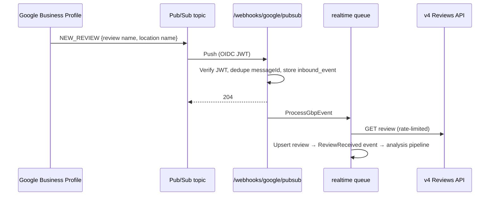

# 07 — API Integration Specification

> ⚠️ **Verify before coding.** Facts marked [V] were confirmed through search results that quoted the official Google pages, because direct fetch of developers.google.com was blocked in the research sandbox. Facts marked [T] come from prior knowledge of the API. A developer must read the official references end-to-end before Phase 2.

## 1. Google Business Profile: the API landscape

The "Google My Business API" was split into several APIs. Reviews **remain on the legacy v4 API** [V].

| API                                         | Base                                              | Used for                                                                         | Label                                |
| ------------------------------------------- | ------------------------------------------------- | -------------------------------------------------------------------------------- | ------------------------------------ |
| My Business **Account Management** API v1   | `mybusinessaccountmanagement.googleapis.com/v1`   | list accounts, admins                                                            | [T]                                  |
| My Business **Business Information** API v1 | `mybusinessbusinessinformation.googleapis.com/v1` | list locations (`accounts/{a}/locations`), location details, read mask           | [T]                                  |
| **Google My Business API v4** (reviews)     | `mybusiness.googleapis.com/v4`                    | list/get reviews, batchGetReviews, updateReply, deleteReply                      | [V] list and updateReply; [T] others |
| My Business **Notifications** API v1        | `mybusinessnotifications.googleapis.com/v1`       | Pub/Sub notification setting per account                                         | [V]                                  |
| Business Profile **Performance** API v1     | `businessprofileperformance.googleapis.com/v1`    | impressions and actions metrics (optional, Phase 7). Replaces v4 reportInsights. | [V-2]                                |
| Q&A API                                     | n/a                                               | **Discontinued Nov 3, 2025.** Don't build on it.                                 | [V-2]                                |
| Places API (New)                            | `places.googleapis.com/v1`                        | public data for competitor benchmark                                             | [V-2]                                |

OAuth scope: `https://www.googleapis.com/auth/business.manage` [V] (the legacy `plus.business.manage` is also accepted [V]).

## 2. Access requirements & approval (critical path)

From Google's prerequisites page [V] ([prereqs](https://developers.google.cn/my-business/content/prereqs?hl=en), [Unified.to guide](https://docs.unified.to/guides/how_to_set_up_google_business_profile_api_access_and_get_oauth_2_credentials)):

1. Create a Google Cloud project for ReviewPilot.
2. The applicant must **manage a Google Business Profile that is verified and active for 60+ days**, and the profile must list **a website representing the business**. The applicant email must be an owner or manager of that profile.
3. Submit the **GBP API contact form** and choose "Application for Basic API Access".
4. Until approved, the quota shows **0 QPM** and calls fail. Approval sets **300 QPM** [V]. The approval decision arrives by email. Timing ranges from days to weeks [V-2].
5. A quota increase can be requested later via the Cloud Console Quotas page [V-2].

Additional (**to verify**):

- **OAuth consent screen verification:** `business.manage` is likely a _sensitive_ scope, requiring Google app verification (privacy policy, homepage, domain verification, demo video) before going beyond 100 test users [T]. Budget 2–6 weeks [A].
- Read the **GBP API Terms of Service** and **Google API Services User Data Policy** for display, storage and deletion obligations. Record the conclusions in an ADR.

> **Action for week 1:** create ReviewPilot's own Business Profile (office address or service-area business) and website, verify it, and start the 60-day clock. Without it, no API access is possible.

## 3. Endpoint specification

### 3.1 Discovery

```
GET https://mybusinessaccountmanagement.googleapis.com/v1/accounts           [T]
GET https://mybusinessbusinessinformation.googleapis.com/v1/{parent=accounts/*}/locations
    ?readMask=name,title,storefrontAddress,metadata,regularHours,websiteUri,categories,
     phoneNumbers,openInfo&pageSize=100                                       [T]
```

- `metadata.placeId` gives the Places link. `metadata` also has flags for verification and duplicate state (exact field names [T]: check).
- Location `name` is `locations/{id}`. The v4 reviews path needs `accounts/{accountId}/locations/{locationId}` [T].

### 3.2 Reviews

```
GET  https://mybusiness.googleapis.com/v4/{parent=accounts/*/locations/*}/reviews
     ?pageSize=50&pageToken=…&orderBy=updateTime desc                         [V]
```

- `pageSize` max **50** [V]. `orderBy` ∈ `rating`, `rating desc`, `updateTime desc` (default) [V].
- The response includes `reviews[]`, `averageRating`, `totalReviewCount` and `nextPageToken` (absent on the last page) [V].
- **Only valid for verified locations** [V].

```
GET  https://mybusiness.googleapis.com/v4/{name=accounts/*/locations/*/reviews/*}               [T]
POST https://mybusiness.googleapis.com/v4/{name=accounts/*}/locations:batchGetReviews          [T]
     body: { locationNames: [...], pageSize, pageToken, orderBy, ignoreRatingOnlyReviews }
```

`batchGetReviews` is useful for multi-location polling: one call for several locations, which saves quota [T].

**Review resource** [T]:

```json
{
    "name": "accounts/1/locations/2/reviews/abc",
    "reviewId": "abc",
    "reviewer": {
        "displayName": "Jan",
        "profilePhotoUrl": "https://…",
        "isAnonymous": false
    },
    "starRating": "FOUR",
    "comment": "Lekker gegeten…",
    "createTime": "2026-10-01T18:22:11Z",
    "updateTime": "2026-10-01T18:22:11Z",
    "reviewReply": { "comment": "Dank je wel…", "updateTime": "…" }
}
```

Notes:

- `starRating` is an enum: `STAR_RATING_UNSPECIFIED`, `ONE`…`FIVE` [T].
- Comments Google auto-translates may include "(Translated by Google)" plus the original text block [T]. Parse it and keep the original language text.

### 3.3 Replies

```
PUT    https://mybusiness.googleapis.com/v4/{name=accounts/*/locations/*/reviews/*}/reply   [V]
       body: { "comment": "…" }       → returns ReviewReply
DELETE https://mybusiness.googleapis.com/v4/{name=…/reviews/*}/reply                       [T]
```

- Verified locations only [V].
- PUT upserts: it creates or replaces the reply [V].
- Google may **reject replies for policy violations**, and the Reviews API now exposes the specific violations [V-2]. Map these into `review_replies.google_policy_rejection` and show them to the user.
- The reply max length is 4,096 bytes [T]. Enforce a lower limit in guardrails.

### 3.4 Notifications (Pub/Sub)

```
GET   https://mybusinessnotifications.googleapis.com/v1/{name=accounts/*/notificationSetting}     [V]
PATCH https://mybusinessnotifications.googleapis.com/v1/{name=accounts/*/notificationSetting}
      ?updateMask=pubsubTopic,notificationTypes
      body: { "name": "accounts/123/notificationSetting",
              "pubsubTopic": "projects/reviewpilot-prod/topics/gbp-events",
              "notificationTypes": ["NEW_REVIEW", "UPDATED_REVIEW"] }                              [V]
```

- **One notification setting per account** [V].
- Grant `mybusiness-api-pubsub@system.gserviceaccount.com` **Publisher** on the topic [V].
- The payload carries the **review resource name and location resource name**, not the full review [V], so we fetch it.
- Empty topic or no types means no notifications [V].
- Deprecated Q&A types must not be requested [V].
- Pub/Sub **push** subscription to `https://app.reviewpilot.eu/webhooks/google/pubsub` with **OIDC token authentication**. Verify the JWT `aud` and `email` claim [T].
- At-least-once delivery: dedupe on `messageId` (`inbound_events` unique).



### 3.5 Usage limits

| Limit                                | Value                                                                                                   | Label |
| ------------------------------------ | ------------------------------------------------------------------------------------------------------- | ----- |
| Default project quota after approval | 300 QPM                                                                                                 | [V]   |
| Before approval                      | 0 QPM                                                                                                   | [V]   |
| Per-location edit limits             | Check the official "Usage limits" page (historically ~10 edits/min per location for some write methods) | [T]   |

Client behaviour:

- A global token bucket in Redis targets ≤ 80% of the quota.
- On 429: exponential backoff (1 s, 2 s, 4 s… max 5 min) with jitter. 429 can also mean "not yet approved" (quota 0) [V-2]. Detect this and surface it in admin.
- On 401: refresh the token once, then mark the connection `needs_reauth`.
- On 403 `PERMISSION_DENIED`: the user lost access to the location. Mark it ineligible.
- On 404: the review was deleted. Set `removed_at`.
- On 5xx: retry with backoff, max 8 attempts.

### 3.6 Client implementation guidance

- Use Laravel's `Http` client with typed DTOs (`ReviewDto`, `ReplyDto`) and a `GbpClient` interface. Avoid the heavy generated `google/apiclient` [A].
- Add a `FakeGbpClient` for tests and local development (fixtures for all edge cases: translated text, rating-only, anonymous, edited review, deleted review, policy rejection).
- Record raw responses in `sync_runs` debug sampling (1%) for diagnosing parsing issues.

## 4. Places API (New): competitor benchmark (Phase 7)

```
GET https://places.googleapis.com/v1/places/{placeId}
Headers: X-Goog-Api-Key, X-Goog-FieldMask: id,displayName,rating,userRatingCount,googleMapsUri
```

- **Field masks drive cost.** Requesting `reviews` triggers the Enterprise + Atmosphere SKU (~$25 per 1,000 [V-2]). `rating` and `userRatingCount` sit in the Enterprise tier (~$20 per 1,000 [V-2]). Check the current SKU mapping.
- At most **5 reviews** are returned [V-2].
- **Caching:** place IDs may be stored. Other content has restrictions [V-2]. Show the required attributions [V-2].
- Text Search or Nearby Search finds competitor `placeId`s once, during onboarding. Store them.

## 5. LLM provider integration

| Aspect    | Spec                                                                                                                                                                                              |
| --------- | ------------------------------------------------------------------------------------------------------------------------------------------------------------------------------------------------- |
| Interface | `LlmClient::structured(PromptRequest $r, JsonSchema $s): LlmResult`                                                                                                                               |
| Providers | OpenAI (primary), second provider adapter (fallback)                                                                                                                                              |
| Models    | Configured per `purpose` in `config/ai.php`. Don't hard-code model IDs. Models change often: the GPT-5.x family has been reported to replace the original GPT-5 models on the pricing page [V-2]. |
| Settings  | Low temperature for analysis, moderate for drafts. Max tokens capped.                                                                                                                             |
| Data      | Opt out of training (API default [T]). Evaluate zero data retention and EU data residency [T].                                                                                                    |
| Batch     | Use the provider Batch API (reported 50% discount [V-2]) for backfill analysis and monthly insights, which are not latency-sensitive.                                                             |
| Errors    | 429/5xx: retry with backoff, then fail over to the second provider after 2 failures. Invalid JSON: one repair retry.                                                                              |
| Metering  | Each call writes `ai_generations` with cost computed from `config/ai_prices.php` (maintained manually and reviewed monthly).                                                                      |

## 6. Billing provider webhooks (Stripe example) [T]

`customer.subscription.created|updated|deleted`, `invoice.paid`, `invoice.payment_failed`. Verify signatures. Store events in `inbound_events`, dedupe on event id. Entitlements are recomputed on every subscription change.

## 7. Outbound notifications

- **Email:** an EU transactional provider (e.g. Postmark EU or Mailgun EU [A]), with SPF, DKIM and DMARC on the sending domain.
- **Slack:** incoming webhooks or an OAuth app (Phase 6).
- **WhatsApp:** WhatsApp Business Platform (Cloud API). Needs pre-approved templates and has per-conversation pricing [T]. Phase 7, alerts only.

## Sources

- Reviews list: https://developers.google.com/my-business/reference/rest/v4/accounts.locations.reviews/list
- updateReply: https://developers.google.com/my-business/reference/rest/v4/accounts.locations.reviews/updateReply
- Notifications: https://developers.google.com/my-business/reference/notifications/rest/v1/NotificationSetting ; https://developers.google.com/my-business/reference/notifications/rpc/google.mybusiness.notifications.v1
- Prerequisites: https://developers.google.cn/my-business/content/prereqs?hl=en
- Places policies: https://developers.google.cn/maps/documentation/places/web-service/policies?hl=en
- Maps pricing: https://developers.google.com/maps/billing-and-pricing/pricing
- Unified.to setup guide: https://docs.unified.to/guides/how_to_set_up_google_business_profile_api_access_and_get_oauth_2_credentials
