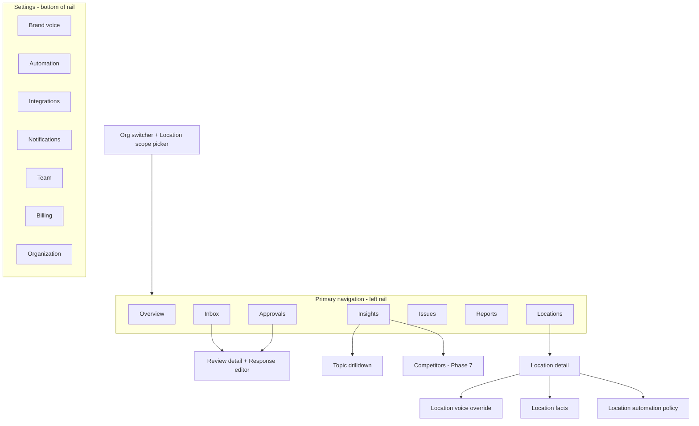

# 08 — UX/UI Sitemap & Screen Specification

## 1. Design direction: "Night service"

Goal: premium, calm and operational, like a well-run kitchen pass at night. It is **not** a generic "AI dashboard": no purple-to-blue gradients, glowing orbs, glassmorphism or sparkles icons.

| Element | Direction |
|---------|-----------|
| **Palette** | Warm graphite base, not pure black: `--bg #0F1012`, `--surface-1 #16181B`, `--surface-2 #1D2024`, `--border #2A2E33`. Text is `#ECEAE6` (warm off-white), with muted `#9A9893`. **One accent: "Brass" `#D9A441`**, for primary actions and focus only. Semantic colours are desaturated: positive `#5FB98A`, warning `#E0A243`, critical `#E2675B`, info `#6FA3D8`. |
| **Star ratings** | Never rainbow. Ratings use a single neutral-to-brass ramp. Critical colour is reserved for *risk*, not for low stars. |
| **Typography** | **Geist Sans** for UI and **Geist Mono** for numbers and IDs (OFL, self-hosted). Display headings are tight (−1.5% tracking). Body text is 14/20, and data tables use tabular numerals. |
| **Density** | Two densities: *comfortable* (default) and *compact* (power users, HQ). The 8 px grid uses 4 px sub-steps. |
| **Surfaces** | Hairline borders over shadows. Elevation comes from the surface colour step. Radius is 10 px for cards and 8 px for controls. |
| **Motion** | 120–180 ms ease-out. A list item slides out when approved. Number tickers run on KPI changes. `prefers-reduced-motion` is respected. |
| **Data viz** | Thin lines, no chart junk, direct labels instead of legends where possible. Use one highlight series and keep the rest neutral. Small multiples for location comparison. |
| **Voice of the UI** | Short, operational, in Dutch first: "3 reviews wachten op goedkeuring" ("3 reviews awaiting approval"), not "Woohoo! 🎉". |
| **Light theme** | Phase 6. Tokens are defined so it is a token swap. Some owners print reports and use daylight. |
| **Accessibility** | WCAG 2.2 AA contrast on dark surfaces (brass on graphite ≥ 4.5:1 for text). Every flow is fully keyboard-operable. |

Component foundation: build an in-house component set on headless primitives (e.g. Reka UI for Vue [T]) with Tailwind 4 tokens, instead of an off-the-shelf themed kit. Off-the-shelf kits produce the generic look we want to avoid.

## 2. Navigation structure

A global **location scope picker** (All locations / Region tag / single location) sits at the top. It filters every screen and is persisted in the URL (`?loc=`). A command palette (`⌘K`) handles jumps: locations, reviews by text, settings.

Mobile: a bottom tab bar (Inbox, Approvals, Insights, More), with the approval flow optimised for one-handed use.

## 3. Screens

### 3.1 Overview (Dashboard)
**Purpose:** "How are we doing, and what needs me today?" in under 10 seconds.
- **Today strip:** awaiting approval (count + oldest age), high-risk unanswered, auto-published in the last 24 h (with undo link during the hold window), sync health.
- **KPI row (selected period vs previous):** average rating (period), review volume, response rate, median response time, net sentiment. Each has a sparkline.
- **Rating trend:** 90-day line of the rolling 30-day average, with an annotation layer (issues resolved, voice changed).
- **Top movers:** topics whose negative share rose or fell most, linking to drilldown.
- **Locations table** (multi-location only): rating, Δ, volume, response rate, open issues, with sorting and small-multiple sparklines.
- Empty state: a guided checklist (connect Google → choose locations → set voice → approve first reply).

### 3.2 Reviews Inbox
**Purpose:** a triage workspace for all reviews.
- Split view: list on the left (virtualised), detail on the right (desktop). Full-screen detail on mobile.
- Filters: status (needs reply, awaiting approval, scheduled, published, no action), rating, location, topic, risk flag, language, date, "replied outside ReviewPilot". Saved views.
- List row: stars, reviewer name (or "Anonymous"), location chip, one-line AI summary, topic chips, risk badge, age, state pill.
- Bulk actions: assign, mark no-action, approve (low-risk only).

### 3.3 Approval Queue
**Purpose:** the fastest possible path from draft to approved.
- Card-stack or focused list sorted by priority (risk, then age).
- Each item shows the review, analysis chips, and the **selected draft** with variant tabs.
- Actions: Approve (`A`), Edit (`E`), Regenerate with hint (`R`), Reject (`X`), Skip (`J`).
- Two-step approval indicator for HQ-required items.
- A progress indicator ("4 of 11") that ends with a satisfying empty state.

### 3.4 Review Detail
**Purpose:** full context for one review.
- Review text, with original language plus translation toggle. Highlighted evidence spans are colour-linked to topics.
- **Analysis panel:** sentiment, topics with polarity, entities (dishes, staff mention), risk flags with reasons, and "why this needs a human".
- **Response editor** (3.5) embedded.
- **Timeline:** received, analysed, drafted (model, voice version), edited by, approved by, published, edits (from audit_logs).
- Linked Issues, with "Create issue from this review".
- Reviewer's other reviews at our locations, when the same display name and location appear (heuristic, labelled as such).

### 3.5 AI Response Editor
**Purpose:** edit with confidence, without fighting the AI.
- Variant tabs (Short / Standard / Warm), a rich plain-text editor with character and word count, and a language indicator.
- **Guardrail chips:** "Uses fact: opening hours ✔", "Forbidden phrase ✖", "Similar to reply from 3 Oct".
- A "Regenerate with…" box with quick hints: shorter, more formal, apologise more, mention [fact], don't mention [topic].
- Diff view vs the AI original (feeds the acceptance metric).
- Preview as it appears on Google (owner reply styling, approximate).
- Publish now / Schedule / Save draft.

### 3.6 Analytics → "Insights"
**Purpose:** understand performance and drivers.
- Tabs: **Performance** (rating, volume, response KPIs), **Topics** (treemap or bar of topic share × net sentiment; trend per topic), **Dishes** (Phase 5), **Comparison** (locations as small multiples; topic heatmap location × topic, z-scored).
- Every chart is clickable to the underlying reviews.
- Sample-size warnings ("Based on 7 reviews: interpret carefully").

### 3.7 Reputation Intelligence → merged into "Insights" + "Issues"
A separate "Reputation intelligence" screen would duplicate Insights, so it is split:
- **Insights → Alerts feed:** spikes, rating drops, unusual patterns, each with an explanation and evidence.
- **Monthly narrative:** an AI-written, aggregate-grounded summary with citations to reviews.
- **Issues** (own nav item): kanban or list of operational issues, with outcome charts (before/after complaint rate).

### 3.8 Locations
**Purpose:** manage branches.
- List with connection status, verification, sync freshness, mode, voice (inherited or override), billing status.
- **Location detail:** stats, facts sheet editor, voice override, automation policy, team with access, menu items (Phase 5), competitors (Phase 7).

### 3.9 Competitors (Phase 7)
**Purpose:** a light benchmark.
- Up to 5 nearby competitors per location (chosen via Places search).
- Live current rating and review count vs yours, with Google attribution displayed.
- No historical charts unless legal review confirms caching is permitted.

### 3.10 Brand Voice (AI personality settings)
**Purpose:** define how we sound.
- Org default plus per-location overrides, with "inherited / overridden" markers per field.
- Sliders and toggles ([04 §D](04-feature-specification.md)), phrase lists, guidelines editor.
- **Live preview:** three sample reviews regenerate as you tweak (debounced, rate-limited).
- Version history with diff and rollback.
- "Learn from my replies" wizard.

### 3.11 Automation (part of settings, also on location detail)
- Mode per location, with an org ceiling.
- Policy thresholds, hold window, daily cap, business hours.
- **Simulation:** "With these settings, last month 64% of reviews would have been auto-published." This builds trust before enabling.
- Kill switch, prominent and with a confirmation.

### 3.12 Integrations
- Google connections: accounts, status, reauth, the locations per account, notification registration status.
- Slack and Teams (Phase 6), WhatsApp (Phase 7), POS and reservation partners (later).

### 3.13 Notifications
- Per user: event × channel matrix (new negative review, awaiting approval > X h, spike alert, sync problem, weekly digest, monthly report).
- Quiet hours. Digest timing.

### 3.14 Team
- Members, org role, location access (multi-select), 2FA status, last active.
- Invitations (pending, resend, revoke).
- Audit log viewer (filter by user, action, date). Owner and admin only.

### 3.15 Billing
- Current plan, billable locations count, next invoice estimate, payment method (iDEAL/SEPA/card), invoices list (PDF), usage meters (AI reviews this month vs allowance).
- Upgrade or downgrade with a proration preview, and cancellation with an exit survey.

### 3.16 Organisation settings
- Name, legal details, VAT, address (for invoices), default language and time zone.
- Data and privacy: retention settings, data export (JSON/CSV), DPA download and acceptance, delete organisation (with a typed confirmation and a 30-day grace period).
- Security: enforce 2FA, session lifetime, allowed sign-in methods.

### 3.17 Onboarding (flow, not a screen)
1. Sign up → 2. Create org (name, country) → 3. Connect Google → 4. Select locations (with eligibility flags) → 5. Voice quick setup (tone presets or "learn from my replies") → 6. Mode choice (Manual recommended initially, with a Smart Approval explanation) → 7. Backfill progress + "approve your first 3 replies" → 8. Invite team.

Time-to-value target: **first approved reply within 10 minutes of signup** [A].

### 3.18 Internal admin (Filament)
Organisations, users, impersonation (audited), connection health, sync runs, failed jobs replay, AI cost per org, plan management, global kill switch, prompt version registry, eval results.

## 4. Responsive behaviour

| Breakpoint | Layout |
|-----------|--------|
| ≥ 1280 px | Left rail + split inbox (list/detail) + optional right analysis column |
| 768–1279 | Collapsible rail, list/detail toggle |
| < 768 | Bottom tabs, full-screen detail, sticky action bar for approval |
