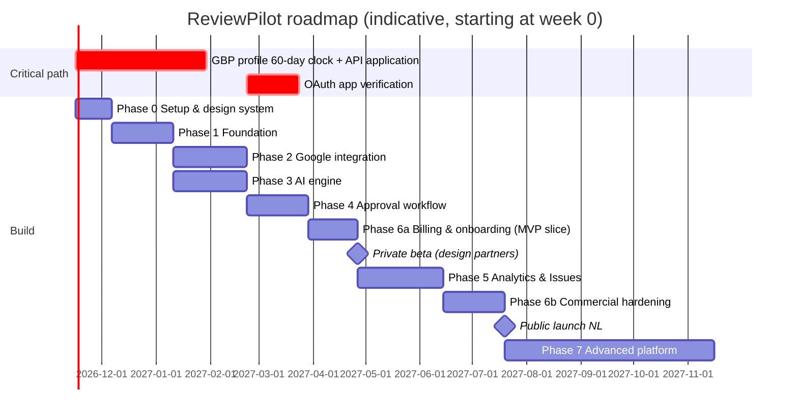

# 11 — Development Roadmap

**Team assumption [A]:** 2 senior full-stack engineers (Laravel + Vue), 1 part-time product designer (≈ 0.5 FTE), 1 founder handling product, sales and design partners. Estimates are calendar time and include testing, review and slack. They are ranges, because unknowns are real.

Complexity scale: S (≤ 1 wk), M (1–3 wk), L (3–6 wk), XL (6+ wk).

**Indicative outcome:** private paid beta around **month 6**, public NL launch around **month 9–10**. Phases 2 and 3 run in parallel (one engineer each). The Google Fake client lets Phase 3 and 4 work continue before API approval.

---

## Phase 0: Setup & foundations (2–3 weeks, M)

**Tasks:** create the ReviewPilot GBP profile and website (starts the 60-day clock), Google Cloud project, apply for API access as soon as eligible. Scaffold Laravel 13 + Vue/Inertia/TS, CI (Pint, Larastan, Pest, ESLint, Vitest), Docker Compose, Sentry, environments (local/staging/prod EU). Design tokens + core components (button, input, table, card, badge, toast, dialog, command palette). ADRs for tenancy, billing provider and hosting.
**Acceptance:** green CI on main, staging deploy on merge, design token page live, API application submitted (or a scheduled date).
**Risks:** delay in GBP verification of our own profile.

## Phase 1: Foundation (5–6 weeks, L)

**Tasks:** auth (Fortify, Google sign-in, 2FA), organisations, memberships, location memberships, invitations, roles and policies, `TenantContext`, global scopes, composite FKs, tenant isolation test generator, locations CRUD (manual creation for now), audit logger, app shell (rail, scope picker, ⌘K), Filament admin basics, i18n (NL/EN).
**Dependencies:** Phase 0.
**Technical considerations:** get tenancy right now. It is the most expensive thing to retrofit.
**Acceptance:** a user can sign up, create an org, invite a manager restricted to one location, and that manager cannot access other locations (automated tests on every route). Audit entries exist for all membership changes.
**Risks:** over-engineering RBAC. Keep the fixed role set.

## Phase 2: Google integration (6–7 weeks, L–XL)

**Tasks:** OAuth connect (PKCE, offline), token encryption and refresh with locks, discovery (accounts, locations), import selection UI, `GbpClient` + `FakeGbpClient`, backfill via batches, polling with adaptive cadence, nightly reconcile, Pub/Sub topic + push endpoint + notification setting registration, global rate limiter, error taxonomy and connection health UI, publish/update/delete reply with idempotency, detect external replies.
**Dependencies:** Phase 1. **API approval** for real calls (the Fake client works until then). OAuth verification before more than 100 users.
**Acceptance:** for a real test profile, new reviews appear in under 2 minutes via push (or 15 via poll). Edits are detected. Replies publish and are confirmed. A revoked token surfaces "Reconnect" within one sync cycle. A 429 storm drops no data.
**Risks:** API access denied or delayed (see risk register R1). Undocumented response quirks (translated text, missing fields).

## Phase 3: AI engine (5–6 weeks, L)

**Tasks:** `LlmClient` + OpenAI adapter + fallback adapter, `PromptBuilder` with versioning, analysis schema and job, topic taxonomy seed (NL/EN labels), generation with variants, guardrails (language, forbidden phrases, fact check, similarity, PII, length, moderation), brand voice model + versions + location facts, voice preview, AI metering + budgets, an **eval harness** (300+ labelled reviews, a rubric, CI nightly run).
**Dependencies:** Phase 1 (data model). It can run before Phase 2 using fixtures.
**Acceptance:** on the eval set, ≥ 90% language-correct, 0 fabricated facts in a sample of 100, ≥ 4.0/5 average rubric score from human raters, high-risk recall ≥ 95% on labelled risk cases, p95 generation latency < 12 s.
**Risks:** Dutch tone quality (u/je), repetition across many replies, prompt injection. Mitigate with evals and guardrails.

## Phase 4: Approval workflow (4–5 weeks, L)

**Tasks:** state machine (e.g. a small in-house state machine, with transitions as Actions), inbox, approval queue with keyboard shortcuts, review detail + response editor, regenerate with hint, manual reply, Smart Approval policy engine, hold window scheduler, daily caps, kill switches, circuit breaker, timeline from audit logs, mobile approval UX, simulation ("what would have auto-published").
**Dependencies:** Phases 2 and 3.
**Acceptance:** end-to-end review → analysis → draft → approve → published on Google, with a full timeline. A high-risk review can never reach `publishing` without a human (property-based tests across policy combinations). The kill switch stops scheduled publishes within 1 minute.
**Risks:** race conditions (the customer edits the review while a draft is pending). Handle with a `stale` state and optimistic locking.

## Phase 6a: Billing & onboarding, MVP slice (3–4 weeks, M)

Pulled ahead of Analytics so that the beta is paid.
**Tasks:** plans and entitlements, Stripe (or Mollie) Checkout + portal, per-location quantity sync, trial, invoices with VAT, onboarding wizard, weekly digest email, transactional emails (NL/EN), DPA acceptance, privacy policy and terms pages, OAuth verification submission.
**Acceptance:** a design partner can self-onboard and pay with iDEAL/SEPA. Removing a location prorates correctly.

**→ Milestone: private paid beta with 5–10 design partners (~month 6)**

## Phase 5: Analytics & Issues (6–7 weeks, L)

**Tasks:** daily stats aggregation, KPIs, rating trend, topic analytics, location comparison heatmap, spike detection + alerts, Issues (CRUD, linking, outcome measurement), dish/menu items, monthly PDF report + AI narrative (aggregate-grounded with citations), SLA and leaderboards.
**Dependencies:** a few weeks of real data from beta partners (that is why it comes after the beta starts).
**Acceptance:** the dashboard loads in under 800 ms p95 for a 30-location org. Alerts have under 20% false-positive rate as judged by design partners. At least 3 partners create Issues unprompted.
**Risks:** statistical noise at low volumes. Show sample sizes and use minimum-N thresholds.

## Phase 6b: Commercial hardening (4–5 weeks, M)

**Tasks:** Auto-Pilot GA (gated by flag and acceptance data), Slack/Teams, PWA + push, dunning, plan upgrades/downgrades, usage overage billing, help centre, in-app chat support, churn signals, product analytics (privacy-friendly, EU), light theme, accessibility audit, external pentest (light), DPIA finalised, status page.
**Acceptance:** public launch readiness checklist passes. Restore drill is done. On-call runbooks exist.

**→ Milestone: public NL launch (~month 9–10)**

## Phase 7: Advanced platform (ongoing, 4+ months, XL)

Prioritised by design-partner demand, not built all at once:

1. Review collection campaigns (QR, links, NFC, email via reservation/POS partner integrations), with **no gating** (L).
2. Franchise mode (franchisor / franchisee billing and visibility split) (L).
3. Competitor benchmark via Places, within the terms (M).
4. WhatsApp alerts (M).
5. Additional review sources where official APIs permit (L per source).
6. Public API + partner integrations (L).
7. Agency multi-org mode, then white-label (XL).
8. German language and the DACH go-to-market (M product, L commercial).

## Cross-cutting definition of done

- Tests: unit + feature + tenant isolation. E2E (Playwright) for critical flows: onboarding, approve & publish, billing.
- Audit log entries for state changes.
- i18n strings NL/EN.
- Observability: logs with correlation ID, metrics where relevant.
- Docs: ADR for any architectural deviation from this blueprint.
