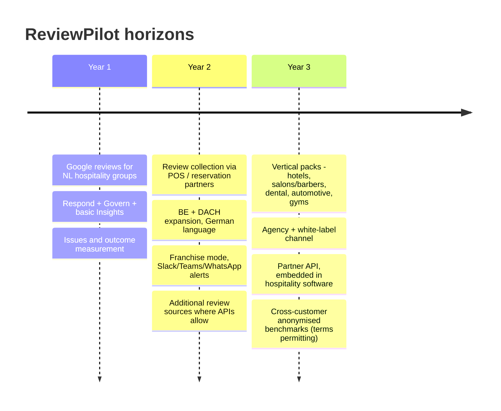

# 14 — Long-Term Product Vision

## Vision statement

**ReviewPilot becomes the operating system for guest reputation in European hospitality and local services.** Every review is answered well, every recurring complaint becomes a tracked fix, and every owner can prove that their operation is getting better.

## Horizons

## Strategic pillars

1. **From replies to outcomes.** The long-term moat is the *closed loop*: complaint → issue → fix → measured improvement. Over time this becomes a dataset of which operational fixes move ratings. It is valuable to customers and hard to copy.
2. **Vertical packs, one platform.** Each new vertical is a *configuration*: topic taxonomy, risk rules, voice presets, fact sheet templates. It is not a fork. Hotels (rooms, check-in, breakfast), barbers (wait times, booking), dental (pain, billing, empathy rules and stricter health-data handling) and automotive (repair quality, pricing transparency) all fit the same engine. Healthcare verticals need extra compliance work (special category data). Sequence them after hotels and personal services.
3. **Embedded distribution.** POS, reservation, booking and practice-management vendors embed ReviewPilot (white-label engine + API). This addresses the CAC problem.
4. **Trustworthy automation.** Publish acceptance metrics, human-gate guarantees and safety records openly. In a market full of "AI slop" replies, being *the safe one* is a brand.
5. **European by design.** EU hosting, multilingual quality (NL/DE/FR/ES/IT), local payment methods and GDPR-native features as a selling point against US suites.

## What we deliberately will not become
- A generic CX suite with SMS inbox, payments and phone systems (Podium/Birdeye territory).
- A review platform with its own consumer reviews (Trustpilot/Kiyoh territory).
- A tool that manipulates reviews (gating, incentives, fake reviews), ever.

## Long-term metrics that matter
- Net revenue retention > 110% (location expansion, vertical packs).
- % of customers with at least one verified improved issue per quarter.
- Median time-to-response across the network.
- Partner-sourced share of new locations > 40%.
